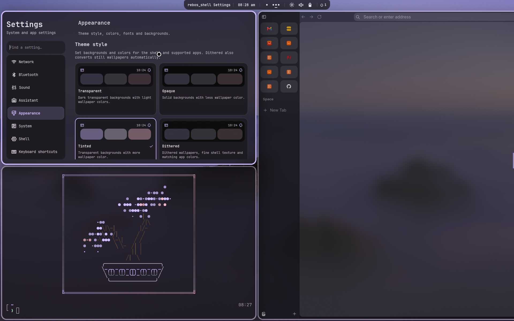
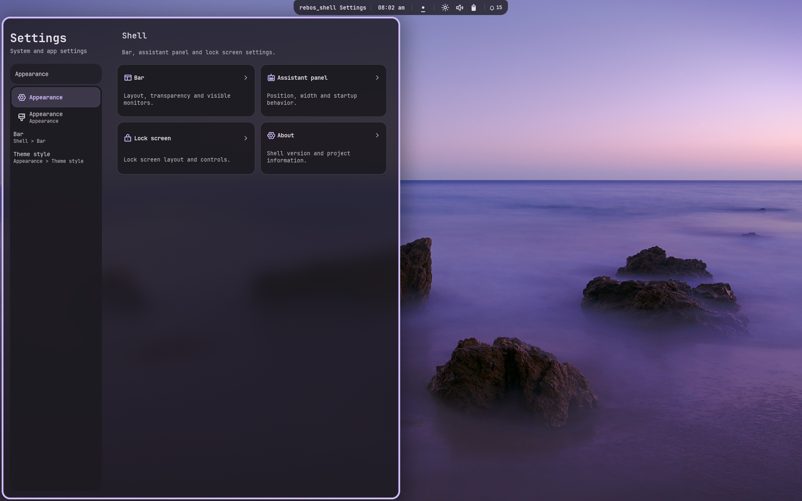

# rebos_enclosure

A complete **Niri + Quickshell desktop for x86_64 Arch Linux**, with matching app themes, Kitty/Fish, Neovim and an interactive installer.

Desktop, laptop and virtual-machine policies are selected on the destination with
`--machine auto` (the default), independently of application groups and GPU drivers.
Use **Settings → GitHub** to select a repository, check local files, review pending
commits, manage branches, and publish changes. Enclosure desktop updates remain
in that panel. Use `./dev.sh` in this checkout for terminal maintenance tools.
See the [development guide](docs/DEVELOPMENT.md) for the workflow and hardware limits.

Source is grouped into **`config/`** (shipped defaults) and **`system/`** (managed code and resources). Personal settings live under **`~/.config/enclosure/`**. See the [filesystem guide](docs/FILESYSTEM.md) for migration, updates and recovery.

[Download latest release](https://github.com/Rebo-NS4U/rebos_enclosure/releases/latest) · [Installation guide](desktop/README.md) · [Package list](desktop/packages/README.md)

[v1.8.0 release notes](docs/RELEASE-v1.8.0.md): Frosted Glass themes, screen text selection,
reader improvements, synced lyrics and faster media playback.

## Screenshots





Screenshots show a customized desktop; new installs start with the bundled default preset.

## Features

| Area | Included |
| --- | --- |
| Desktop shell | Island bar, app launcher, dashboard, settings, notification history, system tray, power menu and lock screen. |
| Windows and workspaces | Niri tiling, named workspaces, monitor navigation, edge window controls, configurable shortcuts, window rules and rounded corners. |
| System controls | Wi-Fi, Bluetooth, audio devices and mixer, microphone, brightness, night light, battery, power profiles and system/process monitoring. |
| Clock and dashboard | Calendar, weather, countdown/Pomodoro timer, quick controls and media playback controls. |
| Appearance | Theme styles, transparency, OLED mode, fonts, colors, gradients, borders, animation and blur controls. Wallpaper colors theme GTK, Qt, the shell and supported apps. |
| Wallpapers | Gallery, search, color-based selection, per-screen choices, image/video support and four bundled 1920×1200 wallpapers. Video backgrounds need the optional mpvpaper package. |
| Everyday tools | File shelf with drag and drop, quick notes, project picker, clipboard history, screenshots, image annotation, OCR and emoji picker. |
| Media | MPV/VLC, the bundled anime/movie/TV/YouTube media browser, playback controls and optional local Whisper captions. Provider playback and captions may need additional setup. |
| Assistant | Separate assistant panel with persistent sessions and backend controls. Install and sign into your preferred agent separately; the default Codex adapter needs Node/npm from the development group. |
| Terminal and editor | Kitty/Fish, custom prompt, wallpaper-colored bonsai, fuzzy finding, navigation helpers, btop and a configured Neovim IDE. Neovim installs its plugins and language tools on first use. |
| App integration | Matching GTK/Qt palettes, fonts, icons and cursor, plus themes for supported apps including Zen, Spotify/Spicetify, Vesktop and VS Code. Some integrations require opening or signing into the app first. |
| Desktop services | NetworkManager, Bluetooth, PipeWire/WirePlumber, desktop portals, keyring, authentication agent and themed ReGreet login. |
| Installer and updates | Core/full profiles, optional app groups, driver and monitor setup, service choices, install previews, backups, recovery and updates that retain personal settings. |

**Optional app groups:** Zen; Discord; Spotify/Spicetify and imv; Obsidian; OBS and scrcpy; VS Code, Node/Python tools, tmux and GitHub CLI; Fastfetch and Flatpak; video wallpapers. The full profile selects all groups. Core includes Thunar, Kitty/Fish and Neovim; select the browser group for Zen.

## Install

Start with a bootable Arch installation, internet access and a normal user with sudo access. This installs a desktop; it does not partition disks or install a bootloader.

Use the [release bundle and instructions](https://github.com/Rebo-NS4U/rebos_enclosure/releases/latest) for a versioned download, or install the latest changes from `main`:

```bash
sudo pacman -Syu --needed git python
git clone --depth=1 https://github.com/Rebo-NS4U/rebos_enclosure.git
cd rebos_enclosure
bash install.sh --interactive --dry-run
bash install.sh
```

Review the preview before installing. Run the installer as your normal user; it requests sudo for system changes and retains AUR review prompts. Setup lets you choose apps, drivers, monitor layout and desktop services.

For a smaller install, use `bash install.sh --profile core`. Add `--no-login` to keep your login manager or `--keep-network` to keep your network setup. See `bash install.sh --help` for all options.

Installs and previews fetch the latest source into a temporary snapshot and print
its commit. They stop if fetching fails, preserving the original checkout and
local edits. Use `--local-snapshot` only when deliberately running the local files
(for example, an offline preview or testing an unpublished change). See the
[installer guide](desktop/README.md) for source and branch overrides.

After installation, reboot and choose **Niri**. **Super+Return** opens Kitty, **Super+Space** opens the launcher, and **Super+Shift+W** opens wallpapers. See [first-login setup and shortcuts](desktop/README.md#first-login) for app initialization and personal keybindings.

To install a specific release, use its exact tag:

```bash
bash install.sh --release v1.8.0 --interactive --dry-run
bash install.sh --release v1.8.0
```

The selector also works with `desktop/install.sh`. Missing tags stop installation;
`--release` cannot be combined with `BRANCH` or `--local-snapshot`.

## Update

Already installed and just want the latest version? Use this to update your system and desktop while keeping your personal settings.

Run from the installer folder you cloned or extracted:

```bash
./update.sh --dry-run
./update.sh
```

The first command previews the update. Log out and back in after applying it.

The updater fetches the current update engine before applying changes, including
when selecting an older release. Apps keep using one installed copy at their
normal paths; the repository remains separate, and fetched snapshots are removed
when the command finishes. Recovery backups are inactive restore points.

If your checkout predates this updater handoff, refresh the launcher once from
its official repository, preserving local work:

```bash
git pull --ff-only
./update.sh --files-only --dry-run
```

If Git reports local changes or diverged history, preserve/reconcile those changes
first. An unchanged historical script cannot gain new update logic remotely.
After this one-time refresh, future updates fetch the current engine automatically.


To update to a specific release:

```bash
./update.sh --release v1.8.0 --dry-run
./update.sh --release v1.8.0
```

Use the exact tag from [GitHub releases](https://github.com/Rebo-NS4U/rebos_enclosure/releases).
Without `--release`, both commands fetch the latest default branch. Release selection
pins desktop files; package upgrades still use current Arch/AUR repositories. Add
`--files-only` to the update command to skip package upgrades. Updating preserves
personal preferences; choosing an older release does not roll back packages.

## Help and recovery

- [Detailed installation, hardware setup and shortcuts](desktop/README.md)
- [Backups and recovery](desktop/README.md#backups-and-recovery) — user backups are saved under `~/.local/state/rebos-desktop/backups/`. File recovery does not undo package or service changes.
- [Package selection](desktop/packages/README.md) and [validation record](desktop/VALIDATION.md). Fresh-machine boot, hardware, package installation and AUR builds still require testing on the destination.

Accounts, credentials, browser profiles and personal chat/media history are excluded from the installer.

## Credits

Based on [jR4dh3y's dots-niri](https://github.com/jR4dh3y/dots-niri), with the bundled rebos_shell derived from Ambxst by Axenide and subsequent contributors. The shell retains its [AGPL-3.0 license](system/apps/shell/LICENSE); bundled components retain their own licenses. Wallpaper metadata includes the [MAKC collection](https://github.com/makccr/wallpapers). See [upstream documentation](UPSTREAM.md).

The Fish bonsai greeting grows above an immediately usable prompt. Typing stays in the command line; submitting a command stops painting before command output begins. Small terminals and `REDUCE_MOTION=1` use a still greeting.

Bonsai foliage uses broad trefoil clusters and diamond leaves with scalloped rims, small branch gaps, and upper-left highlights over shaded undersides. Fine dots soften foliage edges; the trunk keeps solid exposed outlines around spaced bark shading, fine dots, and occasional knots. Foliage colors follow the wallpaper palette with warm sunlit tips, cooler shadows, and subtle patches of reflected light.

Anime playback prefers provider subtitle files that pass encoding detection, conservative English dialogue, cue timing, dialogue density, repetition and episode coverage checks. Unavailable, malformed or sparse files fall back to optional local Whisper captions. These structural checks cannot certify translation accuracy; unverified embedded tracks are not selected automatically. Changes apply on the next player launch.

Provider subtitles support UTF-8, BOM-marked UTF-16 and detected legacy encodings through python-charset-normalizer. English detection uses common dialogue words and rejects uncertain files; it can reject valid unusual English dialogue and cannot judge translation accuracy. Caption language settings control Whisper source audio recognition; subtitle output remains English.

### YouTube For You and account connection

The YouTube panel offers For You, public topic searches, local History, and a separate Auto next toggle. Sign in to YouTube in a supported browser profile (Firefox, Zen, Chrome, Chromium or Brave), select that profile in the panel and press Finish connection. The player verifies a signed-in YouTube session and loads actual recommendations through yt-dlp's recommended feed. Browsing, selecting and playing videos then stays inside the player. Disconnect removes the player's browser-profile selection; it does not sign out the browser. Only that selection is stored locally; browser cookies are read when needed and never exported into the application or repository. Browser session expiry, cookie decryption or YouTube changes can require reconnecting. The official YouTube Data API does not provide the personalized Home feed.

Auto next advances after a successful YouTube video end through the currently loaded feed/search cards or the selected playlist, without pausing the next video. It stops at the queue's end, when disabled, on playback error or after Stop. Other media retain their existing next-episode behavior. Feed pagination shares a short-lived snapshot; Refresh requests new recommendations. The player does not submit watch-history updates to YouTube, so personalization follows the account's existing YouTube activity.

The media menu uses a larger catalogue area and compact cards across Anime, Movies, TV and YouTube. YouTube topics share the category dropdown. Account connections and YouTube Auto next are under Settings → YouTube; Settings also has separate Playback & subtitles and Movies & TV accounts pages.

During playback, the footer subtitle selector shows the selected source: Off, checked Provided English, locally generated Whisper English (including preparing/unavailable status), or named English tracks from the video. Switching affects only the current video, clears the previous caption display and preserves playback. Provider files remain available when trying Whisper; automatic provider quality checks still apply. Unlabeled/non-English native tracks are excluded. Each new video returns to the provider-first default.

Pressing Play opens the VLC window before episode discovery and stream resolution complete. The same window receives the resolved stream. Closing it cancels pending playback; a failed initial lookup closes the unused preparation window and retains the source error in the media menu. Window startup no longer waits for provider responses; time to the first video frame still depends on the source and buffering.

Catalogue browsing automatically loads more pages to fill the visible grid plus one buffer row, including after resizing, reopening or switching media tabs. Automatic paging pauses on errors, exhaustion, or three consecutive pages that add no new titles; Refresh and Load more remain available.
