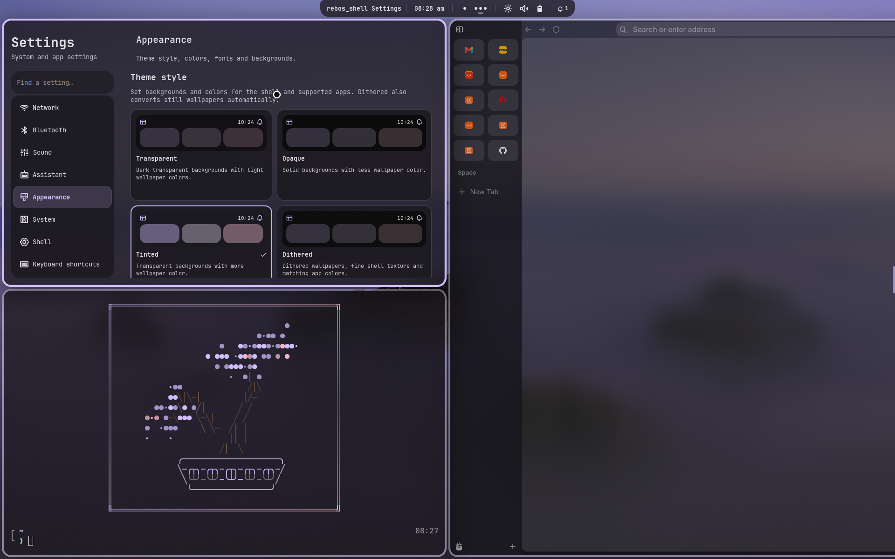

# rebos_enclosure

A complete **Niri + Quickshell desktop for x86_64 Arch Linux**, with matching app themes, Kitty/Fish, Neovim and an interactive installer.

[Download v1.0.0](https://github.com/Rebo-NS4U/rebos_enclosure/releases/latest) · [Installation guide](desktop/README.md) · [Package list](desktop/packages/README.md)

## Screenshots



Screenshots show a customized desktop; new installs start with the bundled default preset.

## Features

| Area | Included |
| --- | --- |
| Desktop shell | Island bar, app launcher, dashboard, settings, notification history, system tray, power menu and lock screen. |
| Windows and workspaces | Niri tiling, named workspaces, monitor navigation, edge window controls, configurable shortcuts, window rules and rounded corners. |
| System controls | Wi-Fi, Bluetooth, audio devices and mixer, microphone, brightness, night light, battery, power profiles and system/process monitoring. |
| Clock and dashboard | Calendar, weather, countdown/Pomodoro timer, quick controls and media playback controls. |
| Appearance | Theme styles, transparency, OLED mode, fonts, colors, gradients, borders, animation and blur controls. Wallpaper colors theme GTK, Qt, the shell and supported apps. |
| Wallpapers | Gallery, search, color-based selection, per-screen choices, image/video support and 149 prepared Urban/Nature wallpapers alongside the original collection. Video backgrounds need the optional mpvpaper package. |
| Everyday tools | File shelf with drag and drop, quick notes, project picker, clipboard history, screenshots, image annotation, OCR and emoji picker. |
| Media | MPV/VLC, the bundled anime/movie/TV/YouTube media browser, playback controls and optional local Whisper captions. Provider playback and captions may need additional setup. |
| Assistant | Separate assistant panel with persistent sessions and backend controls. Install and sign into your preferred agent separately; the default Codex adapter needs Node/npm from the development group. |
| Terminal and editor | Kitty/Fish, custom prompt, wallpaper-colored bonsai, fuzzy finding, navigation helpers, btop and a configured Neovim IDE. Neovim installs its plugins and language tools on first use. |
| App integration | Matching GTK/Qt palettes, fonts, icons and cursor, plus themes for supported apps including Zen, Spotify/Spicetify, Vesktop and VS Code. Some integrations require opening or signing into the app first. |
| Desktop services | NetworkManager, Bluetooth, PipeWire/WirePlumber, desktop portals, keyring, authentication agent and animated Ly login. |
| Installer and updates | Core/full profiles, optional app groups, driver and monitor setup, service choices, install previews, backups, recovery and updates that retain personal settings. |

**Optional app groups:** Zen; Discord; Spotify/Spicetify and imv; Obsidian; OBS and scrcpy; VS Code, Node/Python tools, tmux and GitHub CLI; Fastfetch and Flatpak; video wallpapers. The full profile selects all groups. Core includes Firefox, Thunar, Kitty/Fish and Neovim.

## Install

Start with a bootable Arch installation, internet access and a normal user with sudo access. This installs a desktop; it does not partition disks or install a bootloader.

Use the [release bundle and instructions](https://github.com/Rebo-NS4U/rebos_enclosure/releases/latest) for a versioned download, or install the latest changes from `main`:

```bash
sudo pacman -Syu --needed git python
git clone --depth=1 https://github.com/Rebo-NS4U/rebos_enclosure.git
cd rebos_enclosure
bash install.sh --interactive --dry-run
bash install.sh
```

Review the preview before installing. Run the installer as your normal user; it requests sudo for system changes and retains AUR review prompts. Setup lets you choose apps, drivers, monitor layout and desktop services.

For a smaller install, use `bash install.sh --profile core`. Add `--no-login` to keep your login manager or `--keep-network` to keep your network setup. See `bash install.sh --help` for all options.

After installation, reboot and choose **Niri**. **Super+Return** opens Kitty, **Super+Space** opens the launcher, and **Super+Shift+W** opens wallpapers. See [first-login setup and shortcuts](desktop/README.md#first-login) for app initialization and personal keybindings.

## Update

Already installed and just want the latest version? Use this to update your system and desktop while keeping your personal settings.

Run from the installer folder you cloned or extracted:

```bash
./update.sh --dry-run
./update.sh
```

The first command previews the update. Log out and back in after applying it.

## Help and recovery

- [Detailed installation, hardware setup and shortcuts](desktop/README.md)
- [Backups and recovery](desktop/README.md#backups-and-recovery) — user backups are saved under `~/.local/state/rebos-desktop/backups/`. File recovery does not undo package or service changes.
- [Package selection](desktop/packages/README.md) and [validation record](desktop/VALIDATION.md). Fresh-machine boot, hardware, package installation and AUR builds still require testing on the destination.

Accounts, credentials, browser profiles and personal chat/media history are excluded from the installer.

## Credits

Based on [jR4dh3y's dots-niri](https://github.com/jR4dh3y/dots-niri), with the bundled rebos_shell derived from Ambxst by Axenide and subsequent contributors. The shell retains its [AGPL-3.0 license](desktop/payload/home/.config/quickshell/LICENSE); bundled components retain their own licenses. Wallpaper metadata includes the [MAKC collection](https://github.com/makccr/wallpapers). See [upstream documentation](UPSTREAM.md).
