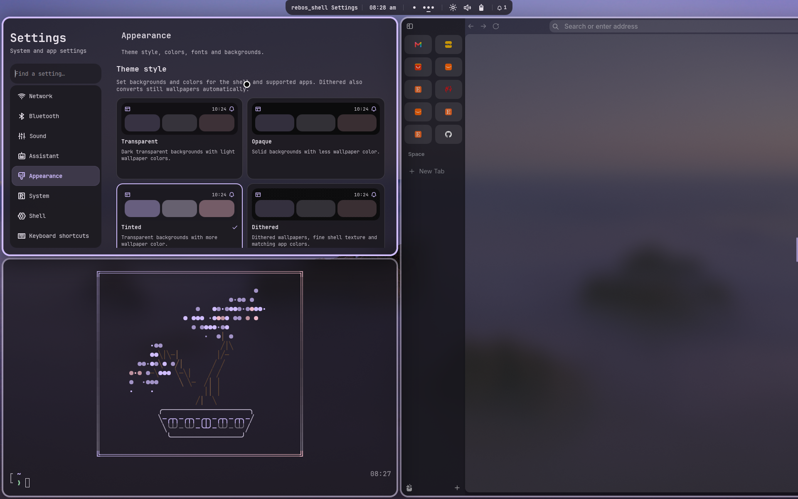
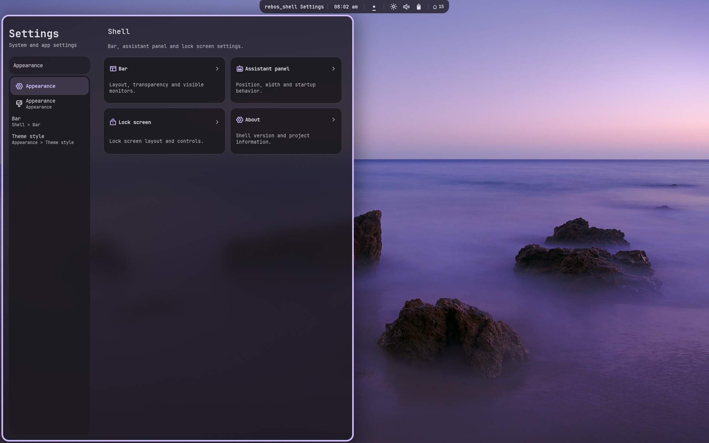

# rebos_enclosure

A complete **Niri + Quickshell desktop for x86_64 Arch Linux**, with matching app themes, Kitty/Fish, Neovim and an interactive installer.

Desktop, laptop and virtual-machine policies are selected on the destination with
`--machine auto` (the default), independently of application groups and GPU drivers.
Use **Settings → GitHub** to select a repository, check local files, review pending
commits, manage branches, and publish changes. The regular desktop update button
is in that panel; newer stable releases also get a highlighted top-bar alert. Use `./dev.sh` in this checkout for terminal maintenance tools.
See the [development guide](docs/DEVELOPMENT.md) for the workflow and hardware limits.

Source is grouped into **`config/`** (shipped defaults) and **`system/`** (managed code and resources). Personal settings live under **`~/.config/enclosure/`**. See the [filesystem guide](docs/FILESYSTEM.md) for migration, updates and recovery.

[Download latest release](https://github.com/Rebo-NS4U/rebos_enclosure/releases/latest) · [Installation guide](desktop/README.md) · [Package list](desktop/packages/README.md)

[2.0 preparation and remaining acceptance gates](docs/RELEASE-2.0-CHECKLIST.md) · [Draft 2.0 notes](docs/RELEASE-v2.0.0.md)

[v1.8.0 release notes](docs/RELEASE-v1.8.0.md): Frosted Glass themes, screen text selection,
reader improvements, synced lyrics and faster media playback.

## Screenshots





Screenshots show a customized desktop; new installs start with the bundled default preset.

## Features

| Area | Included |
| --- | --- |
| Desktop shell | Unified island bar, launcher, dashboard, notification history, system tray, power menu, lock screen and on-demand popouts. |
| Windows and workspaces | Niri tiling, named workspaces, monitor navigation, edge window controls, configurable shortcuts, window rules and shared corner-radius controls. |
| System controls | Wi-Fi, Bluetooth, output devices and mixer, microphone, brightness, night light, battery, power profiles, guarded keyboard/touchscreen toggles and a process-tree resource monitor. |
| Clock and dashboard | Calendar, weather, countdown/Pomodoro timer, quick controls and playback controls. |
| Appearance | Twelve rendered material styles, matching app/terminal surfaces, wallpaper-driven palettes, OLED mode, custom font names and font previews, borders, transparency, blur and reduced-motion controls. |
| Wallpapers | Separate artist/shared-album collections, larger choosers, search, artist and dominant-color sorting, per-screen choices and saved wallpaper/color presets. Optional video backgrounds use mpvpaper. |
| Settings | Category sidebar, top tabs and overview cards, page shortcuts, search with phrase matching, grouped advanced controls and keyboard-accessible fields. |
| Everyday tools | File shelf with drag and drop, quick notes, project picker, clipboard history, resident screenshot editor, annotation/redaction, confidence-aware OCR and emoji picker. |
| Music | Local library and folder playlists, favorites, shuffle/repeat, playback queue, spotDL downloads, cached lyrics, current/next bar lyrics and an output-audio visualizer. |
| Books and typing | Imported reading/typing library, continuous/fullscreen typing, reading progress, word lookup, searchable categorized notes and optional offline Kokoro narration with word highlighting. |
| Video | Anime/movie/TV/YouTube browser, early-opening VLC player, continuing episodes/playlists, subtitle source selection and optional local Whisper captions. |
| Assistant / Dweebo | Independent panel, persistent conversations, background sessions, long-task continuity, session/backend controls, compact composer and collapsible tool details. Agent installation and authentication are separate. |
| Terminal and editor | Kitty/Fish, custom prompt, procedural wallpaper-colored bonsai, fuzzy finding, navigation helpers, btop and configured Neovim. Editor plugins and language tools download on first use. |
| App integration | Shared GTK/Qt palettes, fonts, icons and cursor; matching Kitty, Zen, Spotify/Spicetify, Vesktop and VS Code integration where supported. Some integrations need app setup/sign-in. |
| GitHub | Repository selection and connection repair, local review, branches, commits, outgoing-change review, explicit push/PR actions and desktop update controls. |
| Installer and updates | Core/full profiles, optional app groups, driver/monitor/service choices, verified source snapshots, previews, preserved preferences, source-link support and journaled file recovery. |

**Optional app groups:** Zen; Discord; Spotify/Spicetify, spotDL and imv;
Obsidian; OBS and scrcpy; VS Code, Node/Python tools, tmux and GitHub CLI;
Fastfetch and Flatpak; video wallpapers. Full selects all groups. Core includes
Thunar, Kitty/Fish and Neovim; select the browser group for Zen. The default
assistant Codex adapter needs Node/npm from the development group.

### Material themes and wallpaper collections

Choose Canopy, Orbital, Metropolis, Glass Vault, Radar Station, Suspended Film,
Monolith, Blueprint, Terminal Hardware, Frosted Glass, Tinted or Clear Glass.
Materials follow the chosen palette and corner radius; typography and Kitty
geometry, cursor and tabs follow the selected style. Custom font names remain
supported. Saved presets combine wallpaper and color choices.

Bundled collections currently contain 60 images by Ismail Inceoglu
(Seventeenth), 10 by Cycle Circle (Zombie012), and 62 from the user-supplied
“my wolpapors :3” shared album. Images are at least 1920×1200 in both dimensions.
Fresh installs choose The Stone Sky; existing preferences are retained.
Artist collections include per-image source links; the shared album's individual
artists are unidentified. See the credits below.

### Music, lyrics and downloads

Music combines local playback and downloads in one themed app. Add folders;
subfolders in Music become playlists. Favorite tracks, shuffle, repeat a song
or queue, and use the bounded playback queue. The Downloads page provides
spotDL, format/destination selection, activity output and cancellation; OGG is
the default. Download tools and accounts may require separate setup.

Embedded lyrics and local LRC files are supported; missing lyrics are looked up
on LRCLIB and cached. The bar shows current/next lines with an elapsed-line
progress underline. Plain lyrics use explicitly estimated timing with manual
alignment controls. A spectrum follows the default audio output, never the
microphone; capture runs only while needed and is disabled with reduced motion.
Closing Music preserves active playback/downloads.

### Reading, typing and narration

Typer supports continuous/fullscreen typing and reading, saved progress, book
imports, word lookup and categorized searchable notes. Ctrl+Tab switches typing
and reading during an activity; F11 changes fullscreen mode. Narration offers
Heart, Bella, Michael and Puck, voice previews, speed controls, selected-text or
continuous book reading, stopping limits and spoken-word highlighting.

Voice setup downloads verified Kokoro assets into user data, outside the
installer payload. Once set up, narration is local. Hiding Typer keeps active
narration playing; media controls can reopen, pause or stop it. See the
[reader and narration guide](desktop/README.md) for setup, storage and limits.

### Video, YouTube and subtitles

The media browser combines Anime, Movies, TV and YouTube, fills the visible
catalogue automatically and keeps manual Refresh/Load more controls. Playback
opens the VLC window while resolving the source. Queues continue across regular
seasons or a loaded YouTube feed/playlist; failed or cancelled playback does not
silently advance the queue. Stream interruption recovery and relay caching are
bounded.

YouTube offers For You, topics, search, local History and Auto next. Connect an
existing supported browser profile to load signed-in recommendations through
yt-dlp. Cookies are read when needed, not exported into the repository.
Disconnect removes the player selection without signing out the browser.
Browser expiry or provider changes may require reconnecting; the player does
not submit YouTube watch-history updates.

The subtitle selector offers Off, checked provider English, optional local
Whisper English and named English video tracks. Provider files undergo encoding,
timing, dialogue-density and episode-coverage checks; these checks cannot certify
translation quality. Unavailable or unsuitable files can fall back to Whisper.
Optional multilingual recognition translates into English. Whisper/Silero models
are downloaded separately with pinned digests; they are not shipped in the
payload. Settings/source changes take effect on the next playback launch.

### Assistant continuity and resource use

Dweebo keeps persistent agent sessions separate from its UI, so long silent tasks
can continue through panel reloads. Conversation changes reset editing and
disclosure state without disrupting same-message streaming. Completed tool
details collapse while approval commands remain visible. Idle views and
on-demand tools unload when appropriate; active playback and assistant work are
preserved. Install and sign into the backend you choose separately.

## Install

Start with a bootable Arch installation, internet access and a normal user with sudo access. This installs a desktop; it does not partition disks or install a bootloader.

Use the [release bundle and instructions](https://github.com/Rebo-NS4U/rebos_enclosure/releases/latest) for a versioned download, or install the latest changes from `main`:

```bash
sudo pacman -Syu --needed git python
git clone --depth=1 https://github.com/Rebo-NS4U/rebos_enclosure.git
cd rebos_enclosure
bash install.sh --interactive --dry-run
bash install.sh
```

Review the preview before installing. Run the installer as your normal user; it requests sudo for system changes and retains AUR review prompts. Setup lets you choose apps, drivers, monitor layout and desktop services.

For a smaller install, use `bash install.sh --profile core`. Add `--no-login` to keep your login manager or `--keep-network` to keep your network setup. See `bash install.sh --help` for all options.

Installs and previews fetch the latest source into a temporary snapshot and print
its commit. They stop if fetching fails, preserving the original checkout and
local edits. Use `--local-snapshot` only when deliberately running the local files
(for example, an offline preview or testing an unpublished change). See the
[installer guide](desktop/README.md) for source and branch overrides.

After installation, reboot and choose **Niri**. **Super+Return** opens Kitty, **Super+Space** opens the launcher, and **Super+Shift+W** opens wallpapers. See [first-login setup and shortcuts](desktop/README.md#first-login) for app initialization and personal keybindings.

To install a specific release, use its exact tag:

```bash
bash install.sh --release v1.8.0 --interactive --dry-run
bash install.sh --release v1.8.0
```

The selector also works with `desktop/install.sh`. Missing tags stop installation;
`--release` cannot be combined with `BRANCH` or `--local-snapshot`.

## Update

- **Settings → GitHub → Update Enclosure from main:** apply current main-branch desktop files whenever needed.
- **Top bar → Update available:** appears only for a newer stable GitHub release. Hover for its tag; click to install that exact release.

Both buttons apply immediately with terminal progress, preserve preferences and
create recovery backups. They update desktop files only and keep local-change
and payload-verification protections. The release check runs at startup, every
15 minutes, and when GitHub status is refreshed. Drafts, prereleases and failed
checks do not show the alert.

### Terminal updates

Already installed and just want the latest version? Use this to update your system and desktop while keeping your personal settings.

Run from the installer folder you cloned or extracted:

```bash
./update.sh --dry-run
./update.sh
```

The first command previews the update. Log out and back in after applying it.

The updater fetches the current update engine before applying changes, including
when selecting an older release. Apps keep using one installed copy at their
normal paths; the repository remains separate, and fetched snapshots are removed
when the command finishes. Recovery backups are inactive restore points.

If your checkout predates this updater handoff, refresh the launcher once from
its official repository, preserving local work:

```bash
git pull --ff-only
./update.sh --files-only --dry-run
```

If Git reports local changes or diverged history, preserve/reconcile those changes
first. An unchanged historical script cannot gain new update logic remotely.
After this one-time refresh, future updates fetch the current engine automatically.


To update to a specific release:

```bash
./update.sh --release v1.8.0 --dry-run
./update.sh --release v1.8.0
```

Use the exact tag from [GitHub releases](https://github.com/Rebo-NS4U/rebos_enclosure/releases).
Without `--release`, both commands fetch the latest default branch. Release selection
pins desktop files; package upgrades still use current Arch/AUR repositories. Add
`--files-only` to the update command to skip package upgrades. Updating preserves
personal preferences; choosing an older release does not roll back packages.

## Help and recovery

- [Detailed installation, hardware setup and shortcuts](desktop/README.md)
- [Backups and recovery](desktop/README.md#backups-and-recovery) — user backups are saved under `~/.local/state/rebos-desktop/backups/`. File recovery does not undo package or service changes.
- [Package selection](desktop/packages/README.md) and [validation record](desktop/VALIDATION.md). Fresh-machine boot, hardware, package installation and AUR builds still require testing on the destination.

Accounts, credentials, browser profiles and personal chat/media history are excluded from the installer.

## Credits

Enclosure's upstream code, assets and optional integrations are credited below.
Dependency acknowledgements describe the projects used; they do not imply those
projects authored Enclosure's new features or endorse this distribution.

| Credit | Contribution / attribution |
| --- | --- |
| [jR4dh3y / dots-niri](https://github.com/jR4dh3y/dots-niri) | Original desktop configuration lineage and subsequent shell contributions. |
| [Axenide / Ambxst](https://github.com/Axenide/Ambxst) and its contributors | Upstream shell lineage. rebos_shell is a separately maintained hard fork; its [AGPL-3.0 license](system/apps/shell/LICENSE) is retained. Derived media QML also retains its [AGPL-3.0 license](system/apps/media/LICENSE). |
| [MovieBox-Tui / mesamirh](https://github.com/mesamirh/MovieBox-Tui) and MovieBox Contributors | Adapted MovieBox protocol/signing conventions; [provenance](system/apps/media/vendor/moviebox-tui/SOURCE.md) and [MIT notice](system/apps/media/vendor/moviebox-tui/LICENSE-MIT) are included. |
| [Ismail Inceoglu / Seventeenth](https://seventeenth.artstation.com/) | Artist of the Seventeenth wallpaper collection; [per-image sources](system/share/wallpapers/Ismail%20Inceoglu%20-%20Seventeenth/sources.json). |
| [Cycle Circle / Zombie012](https://zombie012.artstation.com/) | Artist of the Cycle Circle wallpaper collection; [per-image sources](system/share/wallpapers/Cycle%20Circle%20-%20Zombie012/sources.json). |
| Individual artists of “my wolpapors :3” | User-supplied shared collection; individual artists are currently unidentified. [Metadata](system/share/wallpapers/My%20Wolpapors%20-%20Shared%20Album/sources.json) records image hashes/dimensions, not artist ownership. |
| [MAKC / makccr wallpapers](https://github.com/makccr/wallpapers) | Historical wallpaper collection metadata/provenance; not one of the three currently bundled collections. |
| [nlux](https://freesound.org/s/622773/) | “Polite Warning Tone,” Attribution 4.0; [bundled attribution](system/apps/shell/assets/sound/attribution.txt). |
| Abbie Gonzalez / OpenDyslexic | Bundled accessibility font; [copyright and SIL OFL 1.1 notice](system/share/fonts/opendyslexic/OFL.txt). |
| JetBrains Mono, League Gothic and Phosphor font/icon contributors; GoogleDot-Black cursor contributors; Papirus icon contributors | Bundled font/icon/cursor assets and installed icon integration. The GoogleDot-Black metadata does not name an individual creator; no creator is inferred from its Google-inspired name. |
| Arch Linux and package maintainers; Niri, Quickshell, Qt, GTK, Kitty, Fish, Neovim, NetworkManager, PipeWire/WirePlumber, greetd/ReGreet and desktop-portal contributors | Desktop/runtime foundation, packaging and installed tools. See the [package list](desktop/packages/README.md) for the wider dependency set. |
| VLC, mpv, FFmpeg, yt-dlp, spotDL, LRCLIB, Whisper/whisper.cpp, Silero VAD, Kokoro and kokoro-onnx contributors; Spotify/Spicetify contributors | Playback, downloads, lyric lookup, optional captions/narration and app integration. Optional tools/models retain their own upstream terms and setup requirements. |

Artwork rights remain with the respective artists. Collection inclusion or source
attribution is not a claim of authorship by Enclosure or a grant of additional
artwork rights. Original notices remain with their components. See
[upstream sources and attribution details](UPSTREAM.md).
