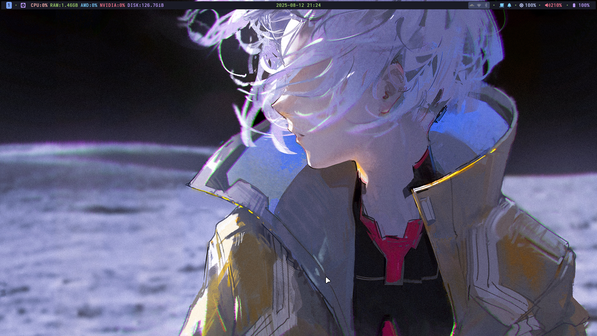

## niri-dots (Arch Linux)

Dotfiles plus an interactive terminal installer.

If you only need the wallpaper assets, see `assets/wal/`.

### Preview



## What the installer does

- Tweaks pacman (Color and Parallel Downloads)
- Adds Chaotic-AUR repo (keyring + mirrorlist)
- Installs prerequisites (base-devel, git, curl, wget, rsync, etc.)
- Installs paru (AUR helper) if missing
- Installs packages from `install/pkg.txt` plus auto-detected CPU/GPU vendor package lists using paru (deduplicated)
- Symlinks repo `.config/` to `~/.config/` and syncs `.local/` into `~/.local/`
- Copies wallpapers from `assets/wal/` to `~/.local/share/wallpapers/`
- Installs the tracked `ly` config into `/etc/ly/config.ini`
- Enables available services: `ly`, `iwd`, `power-profiles-daemon`
- Refreshes the font cache


## Install

1) Clone the repo

```bash
git clone --recursive https://github.com/jr4dh3y/dots-niri.git "$HOME/code/dots-niri"
cd "$HOME/code/dots-niri"
```

2) Optionally edit package lists

- `install/pkg.txt` for the main package list
- `install/pkg-cpu-intel.txt` / `install/pkg-cpu-amd.txt` for CPU microcode
- `install/pkg-gpu-intel.txt` / `install/pkg-gpu-amd.txt` / `install/pkg-nvi.txt` for GPU-specific packages

3) Run the installer

```bash
chmod +x install/install.sh
./install/install.sh
```

By default the installer opens a keyboard-driven terminal UI with arrow-key navigation, space-to-toggle checkboxes, and enter-to-confirm so you can choose between a full install and a custom run.

### One-line bootstrap

If you want a single URL that clones/updates the repo into `~/code/dots-niri` and then opens the regular installer UI, use `oneline.sh`:

```bash
curl -fsSL https://jr4.in/niri | bash
```

or:

```bash
wget -qO- https://jr4.in/niri | bash
```

You can also forward installer flags after the shell separator `--`:

```bash
curl -fsSL https://jr4.in/niri | bash -s -- --sync-only
```

Configure your weather location in the QuickShell dashboard settings.

The installer auto-detects:

- CPU vendor and installs the matching microcode package (`intel-ucode` or `amd-ucode`)
- GPU vendor(s) and installs matching graphics packages for Intel, AMD/Mesa, and/or NVIDIA

## Post-install tips

- Switch your shell to fish (optional): `chsh -s /usr/bin/fish`
- Change wallpaper: `wallpaper ~/.local/share/wallpapers/<file>`

The `wallpaper` command uses QuickShell's wallpaper manager and updates the
shared palette with Matugen. Wallust is a fallback if Matugen is unavailable.
To regenerate colors without changing the wallpaper, run
`colorscheme /path/to/current/wallpaper`.

QuickShell exports its effective palette (including OLED mode and background
opacity) to GTK 3/4, Kitty, Qt 5/6, KDE, Fuzzel, btop, Pywal, NvChad,
VS Code, Zen browser profiles, a Spicetify Spotify theme, and the existing
Vesktop theme. Kitty loads the generated palette after its
fallback colors. Qt palettes use the current user's paths; unrelated app
settings and dotfile symlinks are preserved. Rapid changes keep the newest
pending update for each app, and unchanged palettes skip regeneration.
Kitty and GTK are refreshed live; Fuzzel and btop use the colors on their next
launch, and some Qt/KDE apps need to be reopened. A missing palette cache uses
the shell's built-in colors until a wallpaper or preset generates a palette.

In rebos_shell Settings, **Theme → Wallpaper colors** selects the Matugen
scheme, light/dark mode, OLED blacks, and supported background opacity. It
shows the active wallpaper and palette, can regenerate colors without changing
the wallpaper, and can refresh app themes. **Advanced surface styles** keeps
the shell's gradient and border editors separate from palette generation.
The settings page and wallpaper picker share the same wallpaper state.
**Shell → Bar** selects the continuous or islands layout and whether islands
stay visible. The bar uses the fixed top position.

To install Zen using its official curl installer and set up Spotify/Spicetify,
run `./install/install-themed-apps.sh` from a terminal with network access.
If Spotify is new, the script opens it so you can sign in; rerun the script
after that first launch to activate its theme. Zen loads generated browser
chrome CSS when it starts; VS Code reads updated color settings live, and
Spicetify refreshes colors after its initial `backup apply`. Existing Zen CSS,
profile preferences, and unrelated VS Code JSONC settings are preserved.

### QuickShell desktop

QuickShell is the only session profile. `rice prepare` prepares the Niri profile
before login, and `rice start` starts QuickShell if it is absent. Both Niri and
QuickShell automatically reload configuration changes. `rice status` shows
whether QuickShell is running; `Mod+Z` refreshes external app colors.

QuickShell lives in the `.config/quickshell` git submodule. Set
`REBOS_SHELL_PATH` to use a custom development checkout.
`Mod+Shift+W` opens the wallpaper picker and `Mod+D` opens the dashboard.
The four named workspaces are `web`, `dev`, `chat`, and `media`.

## Troubleshooting

- Pacman is locked: remove the stale DB lock: `sudo rm -f /var/lib/pacman/db.lck`
- Chaotic-AUR key issues: ensure keyserver access or re-run the installer; it retries key import and installs the keyring package.
- AUR build failures: re-run just that package with `paru -S <pkg>` to see full logs.

## Uninstall/rollback notes

- The installer backs up any existing `~/.config/<name>` as `<name>.bak` before linking. You can restore from those `.bak` folders if needed.

---

Made for personal use; adapt as needed. PRs/issues welcome.
