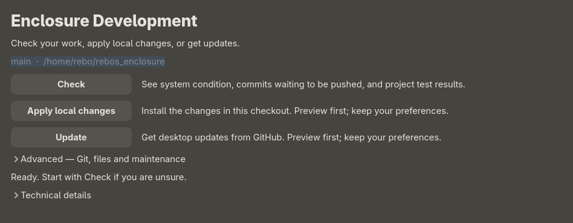
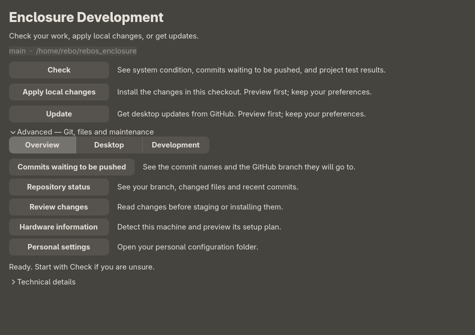

# Rebos Enclosure v1.7.0

A clearer way to maintain your desktop, a Zen-only browser choice, and a collection
of desktop and media reliability improvements since v1.6.0.

## Check, apply, update

The graphical **Enclosure Development** app puts three everyday actions first:
**Check**, **Apply local changes**, and **Update**. Open it from the app launcher
or GitHub Settings. Installation and update actions show a preview before asking
you to continue, preserve personal preferences, and create recovery backups.



Check reports available disk space and memory, failed services, uncommitted files,
and commit names waiting to be pushed. Project tests are reported separately
from live system health; unavailable readings are marked unknown. Technical
output stays collapsed until it is useful.

## Advanced tools when you need them

The expandable maintenance area includes source review, hardware information,
personal settings, installation previews, file organization, staging, commits,
and explicit Git operations. Pending pushes are compared with the last fetched
GitHub state; checking status does not push your work.



## Browser, desktop, and media improvements

- **Zen is the browser choice.** Firefox is removed from required packages,
  installer defaults, command examples, and the Zen launcher's fallback. Core
  installs no browser; select the browser group for Zen. Existing browser
  preferences are retained. The media-control setting now uses a browser-neutral label.
- **Package browsing uses the terminal height**, giving the package picker more
  room while keeping search available.
- **Desktop launchers resolve commands correctly**, including applications that
  need a terminal. The Enclosure launcher also discovers a checkout directly in
  the home directory.
- **Night Light activation and notification history** work more reliably on fresh
  installations. Qt defaults avoid duplicate portal registration from GTK dialogs.
- **VLC installs the FreeType plugin** required by the media player's font options.
  A local subtitle setup command can install missing Whisper engine components;
  models and credentials remain outside the release bundle.
- **Enter/Return activates the next-episode card.** Keyboard focus is exclusive
  only while the card is offered. This preserves the fix shipped in v1.6.1.
- **GitHub Settings explains branch comparisons and pending pushes**, and assistant
  approval messages have cleaner hover styling.

Most maintenance and reliability improvements above were already present in the
v1.6.1 source. Relative to v1.6.1, this release adds the Firefox removal,
browser-neutral labels, this illustrated guide, and a downloadable source bundle.

## Install or update

On an installed x86_64 Arch Linux system, preview before applying:

```sh
bash install.sh --release v1.7.0 --interactive --dry-run
bash install.sh --release v1.7.0
```

For an existing installation:

```sh
./update.sh --release v1.7.0 --files-only --dry-run
./update.sh --release v1.7.0 --files-only
```

Omit `--files-only` to include package upgrades. Files-only updates do not remove
previously installed packages. See the [installation guide](../README.md) for
older updater launchers, optional groups, recovery, and package setup.

The release includes a source archive, SHA-256 checksums, and the screenshots.
Screenshots show the actual maintenance app with a customized desktop theme;
they are not a claim that every installation has the same appearance.

## Verification and limits

- 231 desktop regression tests passed, including media and installation/recovery checks.
- 45 shell tests, four Bluetooth QML test cases, Wi-Fi/Bluetooth service checks,
  and three assistant environment tests passed.
- Payload checksums passed for all 87 installation entries. Python syntax checks
  passed for all 58 shipped Python files.
- Live checks passed for screenshot capture, English OCR, video encoding and MPV
  decoding, brightness queries, battery status, Bluetooth state, power profiles,
  workspaces, and notification, screen-lock and portal D-Bus endpoints.
- All declared core and optional-group packages were installed on the checked
  machine. Local caption engines and models were present. No failed system or
  user services were reported.

Live checks describe one AMD laptop and do not establish universal hardware or
end-to-end feature coverage. Weather, streaming providers, authenticated AI,
actual screen locking, subtitle accuracy, suspend/resume, fresh boot/login and
fresh package installation still require interactive or destination-system tests.
Active desktop services, playback and assistant backends were not restarted.
